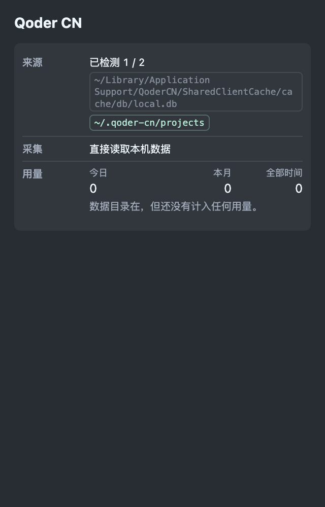
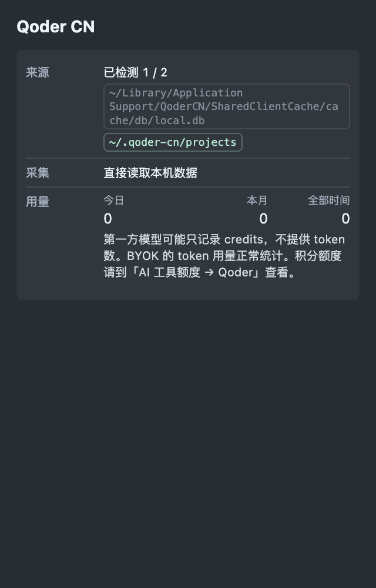
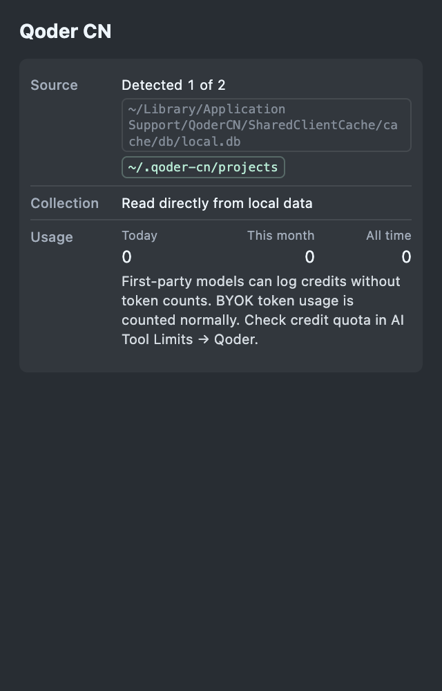

# Qoder CN token availability UI evidence

Synthetic collection-health panel rendered with Token Monitor's production `clientHealthPanel`, `clientHealthGroup`, health presentation helper, i18n and stylesheet in headless Chrome on macOS. The panel is constrained to 320 CSS pixels, matching the narrow widget. No real account data, transcript content or project path is included. This is a component-level browser check, not a packaged Electron or other-platform runtime test.

- Before: upstream `631c25cb4947bd7a75aebf5997bbeadd33cc9c98`.
- After: fix commit `58d43ad`.
- Same synthetic source checks and zero-token counters in both renders.
- Screenshot asset files live on this evidence-only branch, outside the code PR diff.

| Before | After |
| --- | --- |
|  |  |

