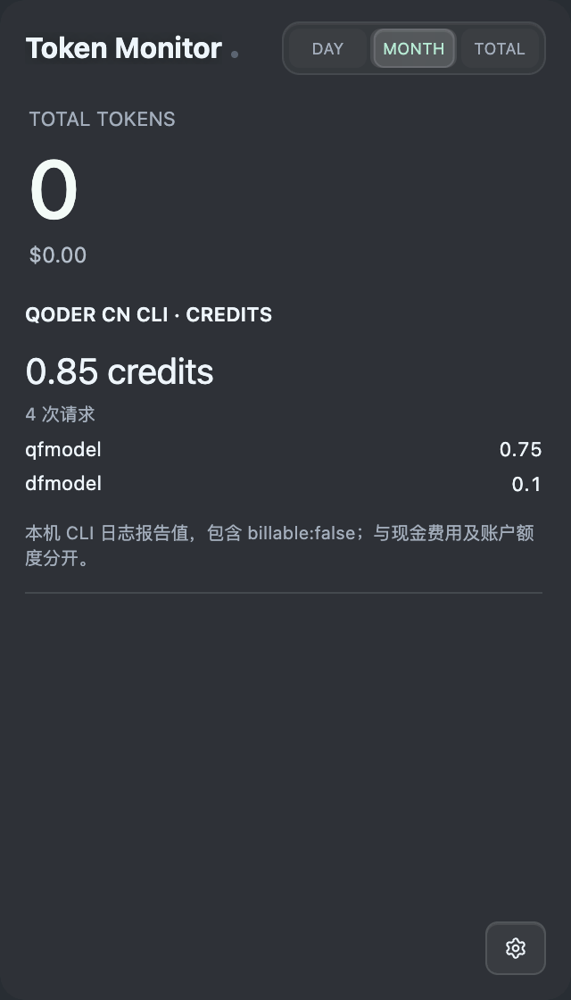
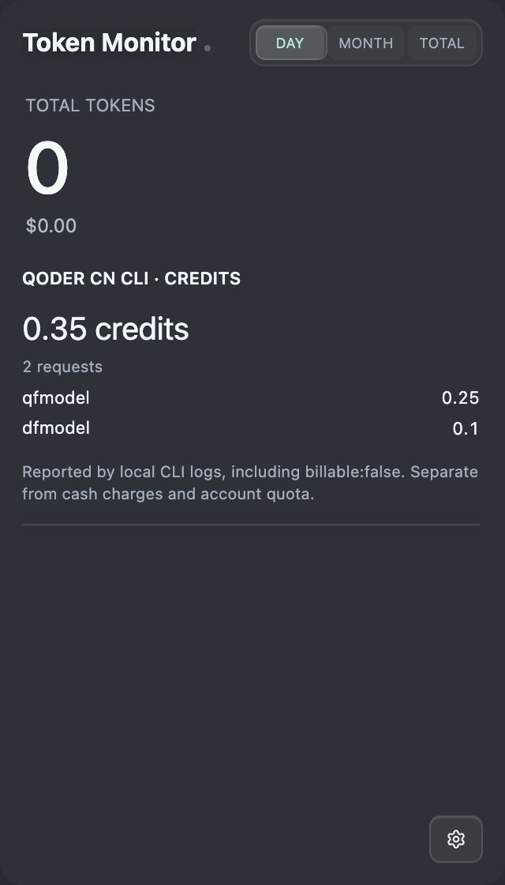
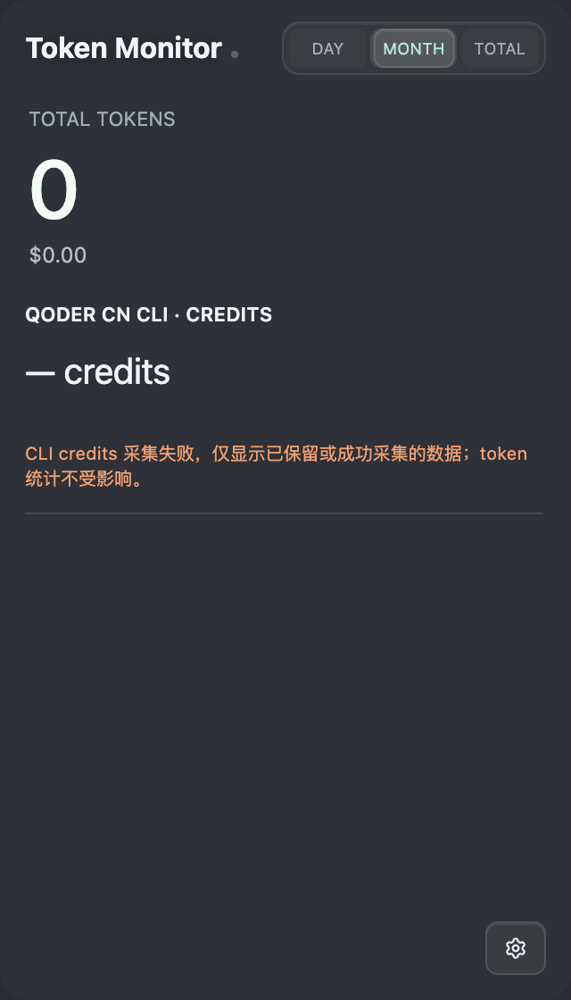

# Qoder CN CLI reported credits UI evidence

Synthetic data rendered in Token Monitor's production DOM, stylesheet, i18n, fixed-period helper, `renderHomeCreditsModule()` and credits view from implementation commit `bff9131e559caa69d35334676579f5c8885c90f0`. An isolated Chromium fixture replaces IPC/app bootstrap; this is a component-level browser check at 320 CSS pixels on macOS, not a packaged Electron or other-platform runtime test.

The fixture exercises DAY/MONTH/TOTAL selection (0.35 / 0.85 / 3.35 credits), while token totals and dollar cost remain zero. It also shows a failed first scan as unknown credits with a visible warning. No real account, transcript or project data is included. These assets are on an evidence-only fork branch, outside the code PR diff.

| Monthly credits (Simplified Chinese) | Daily credits (English) |
| --- | --- |
|  |  |

